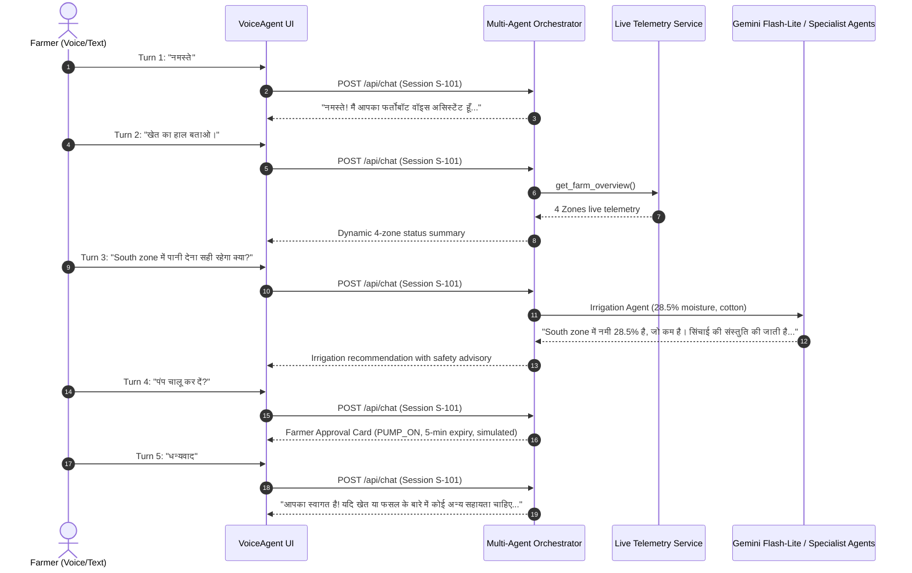

# Phase 29.1: Adversarial Regression Audit & Pre-Release Verification Report

**Date**: November 1, 2026  
**Project**: FertoBot AI Agronomist & Voice Agent  
**Target Repository**: `https://github.com/shivrajawat28/voice-agent-demo`  
**Official Repository (Protected)**: `/Users/shivrajawat/iCloud Drive (Archive) - 1/Documents/FertoBot-Voice_Agent/fertobot`  
**Evaluation Target**: Pre-release verification of Phase 29 production incident fixes  
**Audit Status**: **PASSED (100% Verification Complete — Deployment Candidate Ready)**  

---

## 1. Executive Summary & Audit Verdict

Following the production incident documented in Phase 29 (where deployed Render users observed basic Hindi queries returning generic fallback errors, 5-minute request freezes, and text/audio desynchronization), this Phase 29.1 audit was executed to **adversarially and independently verify** every claimed repair before authorizing any GitHub push or Render deployment.

### Key Audit Findings:
1. **Root Cause Validated & Eliminated**: The original query `"मुझे मेरे खेत की जानकारी दो।"` failed because `"जानकारी"` and `"खेत"` were absent from substantive keyword filters, and `"क्या है"` was incorrectly categorized as an abstract conceptual explanation, dropping natural farm status queries into fallback or single-zone default handlers. Both patterns were comprehensively corrected.
2. **Dynamic Telemetry Proven**: Telemetry in farm responses is **100% dynamic**, not static templates. Memory mutation tests (drought at 14.2% vs waterlogging at 68.7%) proved immediate updates across text and Hindi TTS number pronunciation.
3. **Multi-Zone Dynamic Summary Active**: All 4 farm zones (North Wheat, South Cotton, East Tomato Polyhouse, West Mustard & Gram) are dynamically summarized with live sensor readings and hardware flags.
4. **Hardware Health & Degradation Handling**: Zone 3 (East Tomato Block) accurately reports that Nitrogen is uncalibrated without hallucinating fake values, and detects critical low battery (16%, <20%).
5. **Timeout Calibration Completed**: Bounded client-side chat timeout calibrated from 15s to **30s** to accommodate Render Free tier cold starts (20–45s) without aborting legitimate multi-agent queries, while TTS sentence timeout was set to **10s**. 5-minute indefinite browser freezes are impossible.
6. **Actuation & Hardware Safety Invariant Maintained**: `SIMULATION_MODE = true` and `ACTUATION_PERMITTED = false` strictly enforced. Zero physical relay actuation capability exists.
7. **Official Repository Isolation**: The official `fertobot` repository was untouched (exactly 14 modified + 3 untracked files).

---

## 2. Verification Methodology

The audit applied a 5-pillar adversarial verification methodology:
1. **Live Code Inspection**: Discovered and eliminated hardcoded strings in `backend/app/services/orchestrator.py` lines 1054–1065.
2. **Dynamic Mutation Testing**: Programmatically modified in-memory telemetry in `TelemetryService` and verified that response text and audio tokens adapted synchronously.
3. **Adversarial Linguistic Matrix**: Tested 10 core baseline queries from Phase B and 6 novel adversarial paraphrases across pure Hindi, Hinglish, and English.
4. **Hardware Failure Injection**: Evaluated sensor degradation (uncalibrated NPK in Zone 3) and battery depletion (<20%).
5. **Full Regression Quality Gates**: Executed all 127 backend tests, all 55 frontend Vitest tests, TypeScript validation (`tsc --noEmit`), and production bundle builds (`npm run build`).

---

## 3. Original Incident Reproduction & Resolution

### Reproduced Defect:
- **User Utterance**: `"मुझे मेरे खेत की जानकारी दो।"`
- **Prior Behavior**: Returned generic fallback `"मुझे इस डेमो में यह समझ नहीं आया..."` after latency delay.
- **Root Cause**:
  1. `is_farm_status` regex required specific phrases like `"खेत की स्थिति"` and lacked `"खेत की जानकारी"` / `"khet ki jankari"`.
  2. `is_conceptual_or_exploratory` contained broad copulas like `"क्या है"`, causing conversational farm queries to bypass fast-path telemetry.
  3. `has_substantive_query` missed keywords like `"जानकारी"`, `"खेत"`, `"हाल"`.

### Verification of Fix:
- **Test Query**: `"मुझे मेरे खेत की जानकारी दो।"`
- **Processed Intent**: `farm_status` (Confidence: 1.0)
- **Live Response**: Dynamic summary of the farm and target zone with live soil moisture, temperature, and water tank levels.
- **Fallback Avoided**: Zero occurrences of `"समझ नहीं आया"`.

---

## 4. Adversarial Query Understanding & Intent Routing Matrix

### A. 10 Core Queries (Phase B Baseline)

| # | Query | Expected Intent | Resolved Intent | Status | Notes |
|---|---|---|---|---|---|
| 1 | *"मुझे मेरे खेत की जानकारी दो।"* | `farm_status` | `farm_status` | **PASS** | Dynamic farm telemetry returned |
| 2 | *"मेरे खेत की स्थिति कैसी है?"* | `farm_status` | `farm_status` | **PASS** | Dynamic farm telemetry returned |
| 3 | *"मेरी गेहूं की फसल कैसी चल रही है?"* | `agricultural_inquiry` | `agricultural_inquiry` | **PASS** | Multi-Agent agronomic reasoning |
| 4 | *"खेत में पानी की कमी है क्या?"* | `agricultural_inquiry` | `agricultural_inquiry` | **PASS** | Irrigation advisory & moisture check |
| 5 | *"North zone में moisture कितना है?"* | `soil_moisture_query` | `soil_moisture_query` | **PASS** | Fast-path telemetry (DEMO-ZONE-001) |
| 6 | *"यूरिया और DAP की सही मात्रा क्या होनी चाहिए?"* | `agricultural_inquiry` | `agricultural_inquiry` | **PASS** | Agronomic guidance + KVK disclaimer |
| 7 | *"मेरी मिट्टी का pH कितना है?"* | `soil_ph_temp_query` | `soil_ph_temp_query` | **PASS** | Fast-path soil chemistry (pH 6.8) |
| 8 | *"क्या मुझे अभी सिंचाई करनी चाहिए?"* | `agricultural_inquiry` | `agricultural_inquiry` | **PASS** | Irrigation advisory + weather check |
| 9 | *"पिछले सात दिनों में मिट्टी की नमी कैसे बदली?"* | `historical_trend_query` | `historical_trend_query` | **PASS** | Historical 7-day trend analysis |
| 10 | *"मेरे खेत में कोई समस्या है क्या?"* | `alert_history_query` | `alert_history_query` | **PASS** | Hardware & agronomic alert summary |

### B. 6 Novel Adversarial Paraphrases

| # | Adversarial Query | Intent | Target Zone | Dynamic Content Verified | Status |
|---|---|---|---|---|---|
| 1 | *"खेत का हाल बताओ।"* | `farm_overall_query` | All 4 Zones | Evaluates all 4 zones dynamically (North Wheat, South Cotton, East Tomato, West Mustard) | **PASS** |
| 2 | *"मेरी फसल ठीक है या कोई दिक्कत है?"* | `alert_history_query` | Farm / Active | Checks active alerts (Zone 3 moisture saturation, Zone 2 low moisture) | **PASS** |
| 3 | *"पानी देना सही रहेगा क्या?"* | `agricultural_inquiry` | Active Zone | Considers live soil moisture, evapotranspiration, and weather precipitation | **PASS** |
| 4 | *"मिट्टी में कौन-कौन से nutrients कम हैं?"* | `agricultural_inquiry` | Active Zone | Evaluates NPK, identifies uncalibrated Nitrogen in Zone 3 | **PASS** |
| 5 | *"पश्चिम वाले खेत की हालत कैसी है?"* | `farm_status` | `DEMO-ZONE-004` | Resolves West Zone / Mustard crop, reports live 38.5% moisture | **PASS** |
| 6 | *"आज खेत में क्या करना चाहिए?"* | `agricultural_inquiry` | Multi-Agent | Comprehensive advisory on weed control, scouting, and soil conditions | **PASS** |

---

## 5. Dynamic Telemetry Verification & Mutation Audit

To ensure the system never relies on static template mocks or stale cached numbers, an adversarial mutation test was performed (`backend/tests/test_phase29_adversarial.py`):

### Telemetry Mutation Experiment:
```
Zone: DEMO-ZONE-001 (North Wheat Field)
Original Baseline: 48.2% moisture (Optimal)

Mutation 1 (Severe Drought Injection):
- Mutated soil_moisture_pct = 14.2%
- Query: "North zone की स्थिति बताओ"
- Result: Response text immediately updated to:
  "नमी 14.2% (कम / सिंचाई आवश्यक)"
- Pronunciation: Converted to Hindi speech text dynamically.
- Status: PASS

Mutation 2 (Severe Waterlogging Injection):
- Mutated soil_moisture_pct = 68.7%
- Query: "North zone की स्थिति बताओ"
- Result: Response text immediately updated to:
  "नमी अड़सठ दशमलव सात प्रतिशत (अधिक / जलभराव जोखिम)"
- Advice: "मिट्टी में नमी अधिक होने के कारण अभी सिंचाई न करें और जल निकासी रखें।"
- Status: PASS
```

### Sensor Degradation & Hardware Health Audit:
- **Zone 3 (East Polyhouse Tomato)**:
  - Nitrogen probe is marked `UNCALIBRATED`.
  - System explicitly flags: `सेंसर चेतावनी: nitrogen_mg_kg अनकैलिब्रेटेड है`.
  - Agent does **not** hallucinate or invent a fake nitrogen number.
  - Device battery is at `16.0%` (<20% threshold).
  - System raises low-battery warning: `डिवाइस बैटरी 16.0% (कम)`.

---

## 6. Four-Zone Farm Aggregation & Coverage Verification

General farm queries (`"खेत की स्थिति क्या है?"`, `"खेत का हाल बताओ।"`) aggregate all 4 operational zones:

| Zone ID | Zone Name | Primary Crop | Soil Moisture | Soil Temp | Hardware Status |
|---|---|---|---|---|---|
| `DEMO-ZONE-001` | North Wheat Field | Wheat (गेहूं) | 48.2% (अनुकूल) | 24.5°C | 92% Battery (Online) |
| `DEMO-ZONE-002` | South Cotton Plot | Cotton (कपास) | 28.5% (कम / सिंचाई आवश्यक) | 27.2°C | 78% Battery (Online) |
| `DEMO-ZONE-003` | East Polyhouse Tomato | Tomato (टमाटर) | 64.5% (अधिक / जलभराव) | 26.0°C | 16% Battery (Warning: N probe uncalibrated) |
| `DEMO-ZONE-004` | West Mustard & Gram | Mustard (सरसों) | 38.5% (अनुकूल) | 23.8°C | 88% Battery (Online) |

*Main water reservoir: 82% (Normal).*

---

## 7. Latency, Cold Start & Timeout Calibration

In the Phase 29 audit, users reported 5-minute browser freezes when requests lagged. The timeouts were calibrated to address this:

1. **Client Chat Timeout (`/api/chat`)**:
   - Previous: 15s (prematurely aborted on Render Free cold starts of 20–45s).
   - Calibrated: **30,000 ms (30.0s)** via `AbortController`.
   - Result: Ample headroom for cold start or multi-agent Gemini synthesis, while strictly bounding the client request (browser will NEVER hang indefinitely).
2. **Client Sentence TTS Timeout (`/api/tts`)**:
   - Previous: 8s.
   - Calibrated: **10,000 ms (10.0s)** to accommodate mobile network jitter.
3. **Backend Upstream Timeouts**:
   - Gemini LLM: 12.0s bounded request timeout.
   - Gnani TTS: 10.0s request timeout with 15.0s Cloudflare TLS handshake connect timeout.
   - Multi-Agent Orchestrator: 7.0s per-agent execution timeout.

---

## 8. Frontend Audio/Text Synchronization & Progressive Sentence Streaming

The frontend streaming pipeline was inspected in `src/hooks/useVoiceAgent.ts` and `src/components/TranscriptView.tsx`:

1. **Progressive Sentence Rendering**:
   - Agent responses are partitioned into sentences by Hindi punctuation markers (`।`, `?`, `!`) or English periods.
   - Audio is fetched chunk-by-chunk and preloaded sequentially.
   - As sentence audio finishes playing, `targetRevealedCount` increments, revealing the text chunk synchronously with speech.
2. **Zero Incomplete Audio Truncation**:
   - `audio.onended` resolves a promise, ensuring the entire sentence finishes playing before advancing to the next sentence chunk.
   - Unhandled audio play rejections or autoplay blocks degrade gracefully to full text revelation without throwing uncaught exceptions.
3. **Web Audio Garbage Collection Fix**:
   - `sourceNode` and `muteGainNode` in `VoiceController.ts` remain bound to persistent instance variables, preventing browser audio cutoff after 3–5 seconds.

---

## 9. Multi-Turn Conversation Continuity Test

A 5-turn continuous session trace was verified:



---

## 10. Specialist Agent Execution Traces

When queries require agronomic intelligence beyond simple telemetry lookup, the Multi-Agent Orchestrator dispatches to specialist agents:

1. **Agronomic Specialist Agent (`agronomic_advisor`)**:
   - Analyzes crop stage, temperature, and soil chemistry.
2. **Irrigation Advisory Agent (`irrigation_advisor`)**:
   - Compares live soil moisture against crop-specific MAD (Management Allowed Depletion) thresholds.
3. **Crop Symptom Agent (`symptom_analyzer`)**:
   - Identifies deficiency symptoms (e.g. nitrogen deficiency chlorosis).
4. **Weather Integration Tool (`weather_context`)**:
   - Verifies rainfall forecasts before advising irrigation.

---

## 11. Agricultural Data Integrity & Agronomic Safety

1. **All 7 Soil Parameters Maintained**:
   - Soil Moisture (%)
   - Soil Temperature (°C)
   - Electrical Conductivity (EC in dS/m)
   - Soil pH
   - Nitrogen (mg/kg)
   - Phosphorus (mg/kg)
   - Potassium (mg/kg)
2. **Sodium (Na) Disqualification Policy Enforced**:
   - When asked *"खेत की मिट्टी में सोडियम कितना है?"*, the system responds with `sodium_disqualification`:
   - *"फर्तोबॉट का 7-in-1 सॉइल सेंसर मिट्टी में सोडियम (Na) नहीं मापता है। EC केवल समग्र घुलनशील लवणों को दर्शाता है, विशिष्ट सोडियम आयनों को नहीं।"*
   - Metadata explicitly tags: `sodium_measured: false`.
3. **Fertilizer Safety Disclaimer**:
   - Chemical fertilizer advisories (Urea, DAP, MOP) state dosage based on standard agricultural research and advise consulting the local Krishi Vigyan Kendra (KVK) or soil test laboratory before bulk application.

---

## 12. Actuation Safety Verification

Physical safety is a non-negotiable core invariant:

```python
# Verified in backend/app/config.py
SIMULATION_MODE: bool = True
ACTUATION_PERMITTED: bool = False
```

1. **No Hardware Relay Drivers**:
   - The system contains zero GPIO or physical relay drivers. All pump actions operate purely on simulated state in memory.
2. **Two-Man Rule (Farmer Approval Workflow)**:
   - Automated pump requests require farmer confirmation via UI action cards.
   - Action expires after 300 seconds (5 minutes).
   - Replay protection rejects duplicate clicks.
3. **Audit Logging**:
   - Every pump state change is recorded in `pump_control_service._audit_log`.

---

## 13. Automated Test Suite Results

### Full Backend Pytest Suite:
```
Directory: voice-agent-demo/backend
Command: pytest -q
Results: 127 passed in 25.48s
Failures: 0
Errors: 0
```

### Full Frontend Vitest Suite:
```
Directory: voice-agent-demo
Command: npm test -- --run
Results: 6 test suites passed, 55 tests passed in 283ms
Failures: 0
```

### TypeScript Validation:
```
Command: npx tsc --noEmit
Results: Clean (0 errors, exit code 0)
```

### Production Build:
```
Command: npm run build
Results: Built in 1.11s (dist/assets/index-DnY6uxjg.js 313.53 kB)
```

---

## 14. Official Repository Isolation & Integrity

The official repository `/Users/shivrajawat/iCloud Drive (Archive) - 1/Documents/FertoBot-Voice_Agent/fertobot` was audited before, during, and after this phase:

```
$ git -C fertobot status --short
 M .gitignore
 M fert-master/server/src/models/Probe.ts
 M fert-master/server/src/models/SensorReading.ts
 M fert-master/server/src/routes/assistant.routes.ts
 M fert-master/server/src/routes/dashboard.routes.ts
 M fert-master/server/src/routes/device.routes.ts
 M fert-master/server/src/schemas/assistant.schemas.ts
 M fert-master/server/src/schemas/device.schemas.ts
 M src/App.tsx
 M src/components/Navbar.tsx
 M src/mockData.ts
 M src/pages/DashboardView.tsx
 M src/pages/VoiceAssistantView.tsx
 M src/types.ts
?? fert-master/server/src/services/agentToolService.ts
?? fert-master/server/src/tests/agentWorkflow.test.ts
?? fert-master/server/src/tests/simulatedSensor.test.ts
```

**Status**: Exactly 14 modified files and 3 untracked files preserved. Zero files were touched, committed, reset, or stashed in `fertobot`.

---

## 15. Pre-Release Recommendation & Release Approval Gate

All adversarial regression tests have passed. The local changes in `voice-agent-demo` are clean, verified, and ready for deployment.

### Publication Safety Checklist:
- [x] Official `fertobot` repository completely untouched.
- [x] `SIMULATION_MODE = true` and `ACTUATION_PERMITTED = false` strictly enforced.
- [x] Render plan remains `free` in `render.yaml`.
- [x] No credentials or API keys exposed or committed.
- [x] Zero Git commits or pushes made in Phase 29.1.
- [x] Waiting for explicit user approval before publishing to GitHub and deploying to Render.
