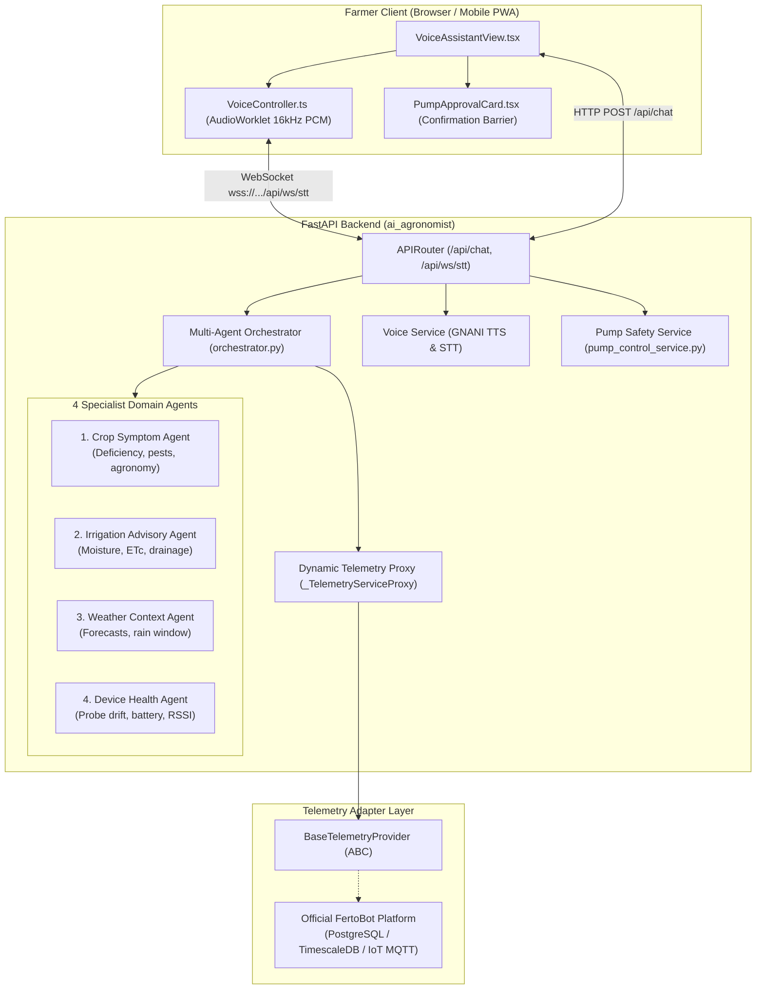

# FertoBot AI Agronomist & Voice Agent

> **Production Staging Release**: Phase 31.1 Standalone AI Agronomist & Reusable Integration Package  
> **Speech AI**: GNANI AI Cloud (Prisma v3.0 Real-Time STT WebSocket + Timbre v2.5 Neural TTS)  
> **LLM Orchestration**: Google Gemini Flash Lite Multi-Agent Architecture (4 Specialist Domain Agents)  
> **Hardware Interface**: Simulated 7-in-1 Modbus RS485 Soil Telemetry & Pluggable Adapter Layer  
> **Safety Boundary**: Strict Simulation Boundary (`simulation_mode=true`, `actuation_permitted=false`)  
> **Repository Boundary**: Completely independent repository. The official `fertobot` repository is strictly isolated and untouched.

---

## 1. Project Purpose

The **FertoBot AI Agronomist (कृषि मित्र)** is an autonomous agricultural voice and reasoning engine built specifically for Indian smallholder and commercial farmers. It delivers real-time spoken Hindi and English agricultural guidance grounded in:
- High-fidelity 7-parameter soil sensor telemetry (Moisture, Temperature, Nitrogen, Phosphorus, Potassium, pH, Electrical Conductivity).
- Scientific crop phenology, threshold diagnostics, and deficit detection.
- Meteorological conditions and rain forecasting.
- Sensor hardware health, calibration, and battery auditing.
- Farmer-supervised irrigation advisory with strict human-in-the-loop confirmation.

The primary deliverable of this project is the **Standalone AI Agronomist Module** located in [`integration-package/ai_agronomist/`](./integration-package/ai_agronomist/), engineered for drop-in integration into the official FertoBot platform.

---

## 2. Architecture & Multi-Agent Orchestration



### The 4 Specialist Domain Agents
1. **Crop Symptom & Agronomy Specialist**: Analyzes foliar visual symptoms, nutrient deficiencies (N-P-K), yellowing, chlorosis, and physiological disorders across Indian crops (Wheat, Mustard, Cotton, Rice, Tomato, Potato).
2. **Irrigation Advisory Specialist**: Calculates soil moisture deficits against field capacity and permanent wilting points. Generates irrigation recommendations paired with explicit farmer confirmation cards.
3. **Weather Context Specialist**: Incorporates ambient temperature, relative humidity, and upcoming rain probability into soil-management decisions to prevent over-irrigation.
4. **Device Health Specialist**: Continuously validates 7-in-1 sensor health, audits uncalibrated or disconnected sensors, monitors battery levels, and flags telemetry anomalies.

### GNANI Indic Voice Pipeline
- **Real-Time Streaming STT (Prisma v3.0)**: Captures 16 kHz 16-bit mono PCM audio from the farmer's microphone over a persistent bidirectional WebSocket proxy (`/api/ws/stt`), delivering low-latency partial and final transcriptions in Hindi and English.
- **Neural Speech Synthesis (Timbre v2.5)**: Synthesizes high-fidelity natural spoken responses using the **Nalini** persona (Indian Hindi) and **Kaveri** persona (Indian English). Includes sentence-level streaming buffers, concurrency ceilings (`asyncio.Semaphore(2)`), and rate-limit backoff.

---

## 3. Standalone Demo vs. Integration Package

This repository contains two distinct representations of the AI Agronomist:

| Aspect | Standalone Demo (This Repository) | Standalone Integration Package |
| :--- | :--- | :--- |
| **Location** | Root repository (`/`, `src/`, `backend/app/`) | [`integration-package/ai_agronomist/`](./integration-package/ai_agronomist/) |
| **Purpose** | Standalone web app for evaluation and staging | Reusable library module for the official FertoBot platform |
| **Packaging** | Full Vite + FastAPI application with mock UI | Standard Python package (`pip install -e backend/`) |
| **Data Layer** | In-memory simulated 7-in-1 telemetry dataset | Pluggable `BaseTelemetryProvider` interface |
| **Frontend** | Complete demo app with theme & status bars | Pure, isolated React components (`<VoiceAssistantView />`) |

---

## 4. Reusable Integration Package Structure

The extracted integration package is located at [`integration-package/ai_agronomist/`](./integration-package/ai_agronomist/):

```text
integration-package/ai_agronomist/
├── README.md                           # Integration guide for official team
├── sample_host_app.py                  # Runnable sample FastAPI host application
├── .env.example                        # Sanitized environment configuration template
├── docs/
│   ├── API_SPECIFICATION.md           # Complete REST API schemas & endpoints
│   ├── WEBSOCKET_SPECIFICATION.md     # Real-time PCM audio streaming protocol
│   └── TELEMETRY_ADAPTER_CONTRACT.md  # Guide to subclassing BaseTelemetryProvider
├── backend/
│   ├── pyproject.toml                 # Standard pip install packaging
│   ├── requirements.txt               # Backend dependencies
│   ├── tests/
│   │   └── test_package_integration.py# 5 self-contained smoke & integration tests
│   └── ai_agronomist/                 # Self-contained Python namespace
│       ├── __init__.py                # Clean top-level exports
│       ├── config.py                  # Environment config & credential redaction
│       ├── api/router.py              # Mountable FastAPI APIRouter (31 endpoints)
│       ├── agents/                    # 4 Specialist Domain Agents
│       ├── providers/                 # LLM, Voice & BaseTelemetryProvider
│       ├── services/                  # Orchestrator, Proxy, Voice, PumpSafety
│       ├── tools/                     # Read-only agricultural telemetry tools
│       ├── models/                    # Pydantic request/response schemas
│       └── utils/                     # IST timezone & sanitization utilities
└── frontend/
    ├── components/
    │   ├── VoiceAssistantView.tsx     # Main AI Agronomist UI container
    │   ├── TranscriptView.tsx         # Progressive transcript timeline
    │   ├── PumpApprovalCard.tsx       # Safety confirmation card
    │   ├── AudioPermissionAlert.tsx   # Browser mic permission handler
    │   ├── VoiceVisualizer.tsx        # Audio waveform visualizer
    │   ├── StateBadge.tsx             # Agent state badge
    │   └── TextFallbackInput.tsx      # Text input fallback
    ├── hooks/useVoiceAgent.ts         # Conversational voice hook
    ├── services/VoiceController.ts    # Web Audio & PCM streaming controller
    ├── types/voiceAgent.ts            # TypeScript definitions
    └── package.json.snippet.json      # Peer dependency declarations
```

---

## 5. Quick Start (Running the Standalone Demo)

### Prerequisites
- Node.js v18+
- Python 3.10+
- Modern browser (Chrome / Edge / Firefox) with microphone support

### 1. Backend Setup
```bash
cd backend
cp .env.example .env
# Set GEMINI_API_KEY and GNANI_API_KEY in .env
pip install -r requirements.txt
python -m uvicorn app.main:app --host 127.0.0.1 --port 8000 --reload
```
- Interactive API Docs: `http://127.0.0.1:8000/docs`
- Health Check: `http://127.0.0.1:8000/api/health`

### 2. Frontend Setup
```bash
npm install
npm run dev
```
- Open `http://localhost:5173/` in your browser.
- Click **"Tap to Speak"** or type in Hindi / English.

---

## 6. How the Official FertoBot Team Integrates the Package

### Step 1: Install the Backend Package
```bash
pip install -e path/to/integration-package/ai_agronomist/backend
```

### Step 2: Mount into Official FastAPI Server
```python
from fastapi import FastAPI
from ai_agronomist import ai_agronomist_router

app = FastAPI(title="Official FertoBot Platform")

# Mounts all 31 endpoints, including /api/chat and WebSocket /api/ws/stt
app.include_router(ai_agronomist_router, prefix="/api")
```

### Step 3: Connect Live Telemetry (Optional)
Subclass `BaseTelemetryProvider` to connect your platform's PostgreSQL, MongoDB, or IoT database:

```python
from ai_agronomist import BaseTelemetryProvider, set_global_telemetry_provider

class OfficialPostgresTelemetry(BaseTelemetryProvider):
    def get_latest_telemetry(self, zone_id: str) -> dict:
        # Query your platform's sensor database...
        return {
            "zone_id": zone_id,
            "soil_moisture_pct": 32.4,
            "soil_temperature_c": 24.1,
            # ...other 7-in-1 parameters
        }

set_global_telemetry_provider(OfficialPostgresTelemetry())
```
*Because the package uses a dynamic proxy (`_TelemetryServiceProxy`), registering a custom provider takes effect immediately without module reloading.*

### Step 4: Mount the React Component
```bash
npm install lucide-react clsx tailwind-merge
```
```tsx
import { VoiceAssistantView } from './ai_agronomist/frontend/components/VoiceAssistantView';

export function AgronomistPage() {
  return <VoiceAssistantView />;
}
```

---

## 7. Required Environment Variables

| Variable | Required | Default | Description |
| :--- | :---: | :--- | :--- |
| `GEMINI_API_KEY` | **Yes** | — | Google Gemini API key for multi-agent reasoning |
| `GNANI_API_KEY` | **Yes** | — | GNANI Cloud API key for Indic STT & TTS |
| `LLM_PROVIDER` | No | `gemini` | `gemini` (production), `openai`, or `mock` (tests) |
| `LLM_MODEL` | No | `gemini-flash-lite-latest` | Model identifier |
| `TTS_PROVIDER` | No | `gnani` | `gnani` (production), `browser`, or `mock` |
| `STT_PROVIDER` | No | `browser` | `browser` (Web Speech fallback) or `gnani` |
| `SIMULATION_MODE` | **Yes** | `true` | Must remain `true` until physical hardware safety signoff |
| `ACTUATION_PERMITTED` | **Yes** | `false` | Must remain `false` to prevent autonomous physical actuation |

---

## 8. Automated Test Suite

```bash
# 1. Full Backend Test Suite (168 tests)
cd backend && pytest -v

# 2. Package Integration & Smoke Tests (5 tests)
cd integration-package/ai_agronomist/backend && pytest tests/ -v

# 3. Full Frontend Test Suite (57 tests)
npm test -- --run

# 4. TypeScript Type Check
npx tsc --noEmit

# 5. Production Vite Build
npm run build
```

---

## 9. Security & Safety Boundaries

1. **Advisory-Only Autonomous Boundary**: The AI Agronomist cannot autonomously turn on pumps, valves, or dosing injectors. Any irrigation recommendation yields a `PumpApprovalCard` requiring physical human confirmation.
2. **Zero Actuation in Simulation**: With `SIMULATION_MODE=true` and `ACTUATION_PERMITTED=false`, no MQTT, Modbus, or GPIO signals are ever transmitted to physical devices.
3. **Multi-Tenant Session & Zone Isolation**: User sessions maintain strictly isolated zone context (`_session_zones`). Cross-session pump approvals are blocked with 404 responses.
4. **Safe Unknown Zone Rejection**: If an unknown zone is requested, the system safely rejects it with a helpful message listing available zones, preventing fallback to Zone 1.
5. **Secret Redaction**: API keys and tokens are automatically stripped from error responses and logs via `redact_sensitive()`.

---

## 10. Hardware Limitations & Handover Assumptions

> [!IMPORTANT]
> **No Claim of Physical Hardware Integration**: This release operates strictly against a simulated 7-in-1 sensor telemetry layer. It does not directly actuate physical pumps, relays, or Modbus registers.

### Handover Checklist for the Official FertoBot Team
1. **Database Schema Mapping**: Confirm whether the official platform's sensor table matches the `BaseTelemetryProvider` contract fields (`soil_moisture_pct`, `nitrogen_mg_kg`, `phosphorus_mg_kg`, `potassium_mg_kg`, `soil_temperature_c`, `ph`, `electrical_conductivity_ds_m`).
2. **Hardware Actuator Service**: Implement a secure relay actuation service invoked only when `pump_control_service.approve_action()` returns status `APPROVED`.
3. **Session Store**: For distributed multi-pod deployments on Kubernetes or ECS, replace the in-memory session store in `orchestrator.py` with Redis.
4. **Authentication Middleware**: Wrap `/api/chat` and `/api/farm/*` in the official platform's JWT or session authentication middleware.
