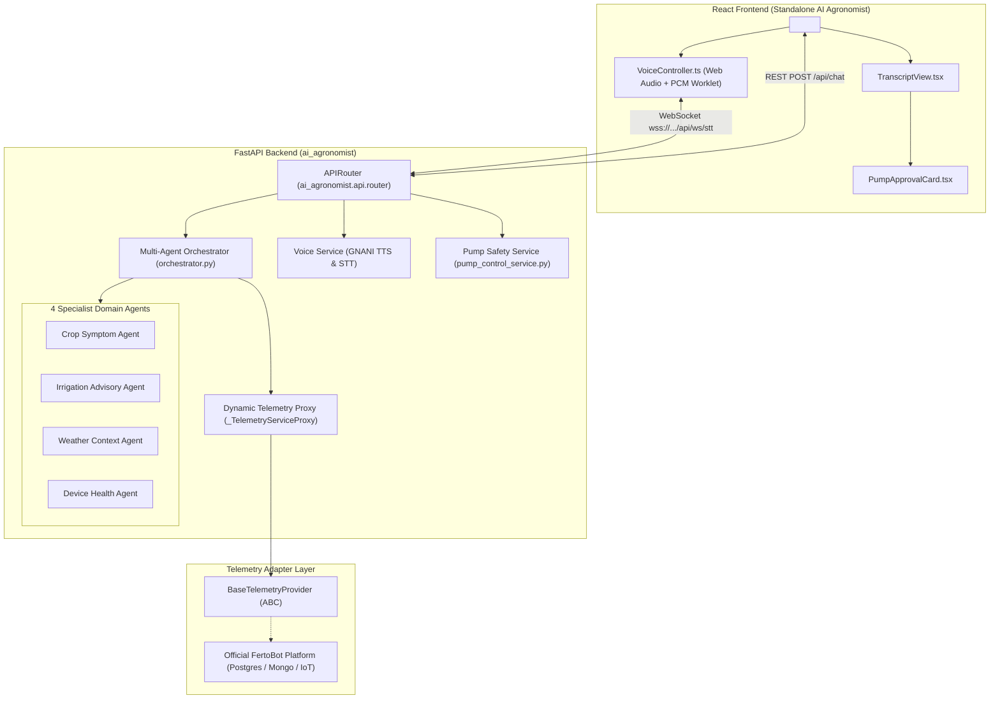

# FertoBot AI Agronomist — Standalone Integration Package

This repository package contains the complete, isolated source code for the **FertoBot AI Agronomist / Voice Agent**.

Designed specifically for seamless integration into the official FertoBot platform, this package provides a production-tested agronomy intelligence engine combining:
1. **Gemini Multi-Agent Orchestration**: 4 specialized agricultural domain agents.
2. **GNANI Indic Voice Pipeline**: Ultra-natural Hindi speech synthesis (Timbre Nalini) and real-time streaming speech recognition (Prisma v3.0).
3. **Pluggable Telemetry Contract**: Abstract interface (`BaseTelemetryProvider`) and dynamic provider proxy ready to connect to production PostgreSQL, MongoDB, Modbus, or MQTT data.
4. **Strict Autonomous Safety Barrier**: Advisory-only reasoning with explicit farmer approval cards for irrigation actions.
5. **Session/Request Zone Isolation**: Multi-tenant zone isolation preventing cross-zone data leakage or state contamination.

---

## Architecture



---

## Directory Structure

```text
ai_agronomist/
├── README.md                           # This integration guide
├── .env.example                        # Template for required environment variables
├── docs/
│   ├── API_SPECIFICATION.md           # REST API endpoints, schemas, status codes
│   ├── WEBSOCKET_SPECIFICATION.md     # Real-time PCM audio streaming protocol
│   └── TELEMETRY_ADAPTER_CONTRACT.md  # Guide to connecting live databases
├── backend/
│   ├── pyproject.toml                 # Standard Python packaging (pip install -e .)
│   ├── requirements.txt               # Backend Python dependencies
│   └── ai_agronomist/                 # Self-contained Python package
│       ├── __init__.py                # Exports top-level router & provider helpers
│       ├── config.py                  # Environment configuration & secret redaction
│       ├── api/
│       │   ├── __init__.py
│       │   └── router.py              # Mountable FastAPI APIRouter (31 endpoints)
│       ├── agents/                    # 4 domain specialist agents
│       │   ├── crop_symptom_agent.py
│       │   ├── irrigation_advisory_agent.py
│       │   ├── weather_context_agent.py
│       │   └── device_health_agent.py
│       ├── providers/                 # LLM, Voice & Telemetry providers
│       │   ├── telemetry_base.py      # BaseTelemetryProvider ABC
│       │   ├── gnani_tts.py           # Timbre Nalini Hindi TTS provider
│       │   ├── gnani_stt.py           # Prisma STT provider
│       │   └── live_llm.py            # Gemini Flash Lite LLM provider
│       ├── services/
│       │   ├── orchestrator.py        # Gemini Multi-Agent Orchestrator (session-isolated)
│       │   ├── conversation_service.py# Conversation state & turn management
│       │   ├── voice_service.py       # Concurrency-capped voice pipeline
│       │   ├── gnani_stt_stream.py    # WebSocket audio streaming proxy
│       │   ├── pump_control_service.py# Safety barrier & approval state machine
│       │   └── telemetry_service.py   # Dynamic proxy & reference telemetry provider
│       ├── tools/                     # Grounded reasoning tools
│       ├── models/                    # Pydantic request/response schemas
│       └── utils/                     # Timezone & sanitization utilities
└── frontend/
    ├── components/
    │   ├── VoiceAssistantView.tsx     # Main AI Agronomist UI container
    │   ├── TranscriptView.tsx         # Message timeline with streaming bubble
    │   ├── PumpApprovalCard.tsx       # Safety confirmation card
    │   ├── AudioPermissionAlert.tsx   # Browser mic permission handler
    │   ├── VoiceVisualizer.tsx        # Real-time audio waveform visualizer
    │   ├── StateBadge.tsx             # Agent state badge
    │   └── TextFallbackInput.tsx      # Text input fallback
    ├── hooks/
    │   └── useVoiceAgent.ts           # Complete conversational hook
    ├── services/
    │   ├── VoiceController.ts         # Audio capture & streaming controller
    │   ├── ConversationEngine.ts      # HTTP dialogue engine
    │   └── AgentStateMachine.ts       # Voice session state machine
    ├── types/
    │   └── voiceAgent.ts              # TypeScript definitions
    ├── utils/
    │   └── timezone.ts                # IST timezone formatters
    └── package.json.snippet.json      # Frontend npm dependency declarations
```

---

## Backend Integration Guide (FastAPI)

### Step 1: Install Python Package
You can install the package directly in editable mode or install requirements:

```bash
# Option A: Install as an editable package (recommended)
pip install -e ./ai_agronomist/backend

# Option B: Install requirements directly
pip install -r ./ai_agronomist/backend/requirements.txt
```

### Step 2: Mount the AI Agronomist Router
In your main FastAPI application (`server.py` or `main.py`):

```python
from fastapi import FastAPI
from ai_agronomist import ai_agronomist_router

app = FastAPI(title="FertoBot Platform")

# Mount AI Agronomist under /api
# All endpoints (REST and WebSocket /api/ws/stt) are registered automatically
app.include_router(ai_agronomist_router, prefix="/api")
```

Top-level exported symbols from `ai_agronomist`:
- `ai_agronomist_router`: The FastAPI `APIRouter` with all 31 endpoints.
- `set_global_telemetry_provider(provider)`: Inject live database adapter.
- `get_telemetry_provider()`: Retrieve currently active telemetry provider.
- `reset_global_telemetry_provider()`: Revert to built-in reference provider.
- `BaseTelemetryProvider`: Abstract Base Class for custom telemetry adapters.
- `telemetry_service`: Dynamic proxy delegating to active provider.
- `orchestrator`: Multi-agent orchestrator instance.
- `pump_control_service`: Hardware safety and pump approval service.

### Step 3: Configure Environment Variables
Copy `.env.example` to your `.env` file and provide your API keys:
- `GEMINI_API_KEY`: Required for multi-agent reasoning (Google Gemini 2.5 Flash Lite).
- `GNANI_API_KEY`: Required for Indic voice (Hindi Nalini voice, Prisma STT).
- `SIMULATION_MODE=true` and `ACTUATION_PERMITTED=false`: Keep these safety boundaries active.

### Step 4: Connect Live Platform Telemetry
To connect your platform's live database (PostgreSQL, MongoDB, IoT MQTT, etc.), subclass `BaseTelemetryProvider` from `ai_agronomist` and register it during server startup:

```python
from ai_agronomist import BaseTelemetryProvider, set_global_telemetry_provider

class LivePlatformTelemetryProvider(BaseTelemetryProvider):
    def get_latest_telemetry(self, zone_id: str) -> dict:
        # Fetch from PostgreSQL / TimescaleDB / Sensor Cache
        row = db.query("SELECT * FROM sensor_readings WHERE zone_id = :z ORDER BY time DESC LIMIT 1", z=zone_id)
        if not row:
            return {}
        return {
            "zone_id": row.zone_id,
            "soil_moisture": row.moisture,
            "soil_temperature": row.temperature,
            "ambient_humidity": row.humidity,
            "nitrogen": row.n,
            "phosphorus": row.p,
            "potassium": row.k,
            "ph": row.ph,
            "ec": row.ec,
            "timestamp": row.time.isoformat()
        }

    # Implement other BaseTelemetryProvider methods...

# Register during application startup
set_global_telemetry_provider(LivePlatformTelemetryProvider())
```

> **Dynamic Resolution**: Because `ai_agronomist` uses a proxy object, calling `set_global_telemetry_provider()` takes effect immediately across all agents, tools, and endpoints without module reloading.

*See `docs/TELEMETRY_ADAPTER_CONTRACT.md` for full implementation examples.*

---

## Frontend Integration Guide (React)

### Step 1: Install Peer Dependencies
```bash
npm install lucide-react clsx tailwind-merge
```

### Step 2: Mount the AI Agronomist Component
In your React application, simply import and render `<VoiceAssistantView />`:

```tsx
import React from 'react';
import { VoiceAssistantView } from './ai_agronomist/frontend/components/VoiceAssistantView';

export function AgronomistPage() {
  return (
    <div className="w-full h-full min-h-screen bg-slate-950 text-slate-100">
      <VoiceAssistantView />
    </div>
  );
}
```

The component automatically handles:
- Browser microphone permissions with user guidance.
- Real-time PCM audio streaming via WebSocket to `/api/ws/stt`.
- Synchronized streaming sentence playback with sentence-by-sentence text reveal.
- Safe pump approval workflow cards with user action buttons.
- IST timezone formatting for all sensor timestamps.

---

## Safety Guarantees

1. **Advisory-Only Autonomous Barrier**: The AI Agronomist cannot autonomously turn on pumps or valves. Any recommendation to irrigate yields a `PumpApprovalCard` requiring human farmer confirmation.
2. **Zero Actuation in Simulation**: With `SIMULATION_MODE=true` and `ACTUATION_PERMITTED=false`, no MQTT, Modbus, or GPIO signals are ever transmitted.
3. **Session & Zone Isolation**: Requests and sessions carry distinct `zone_id` context. Requests for different zones cannot cross-contaminate telemetry, and unknown zones are rejected safely.
4. **Secret Redaction**: All API keys and tokens are automatically redacted from error messages and server logs.
5. **Rate Limit Resilience**: GNANI Timbre TTS includes a strict concurrency ceiling (`asyncio.Semaphore(2)`) with automatic backoff on HTTP 429 (`Retry-After`).
