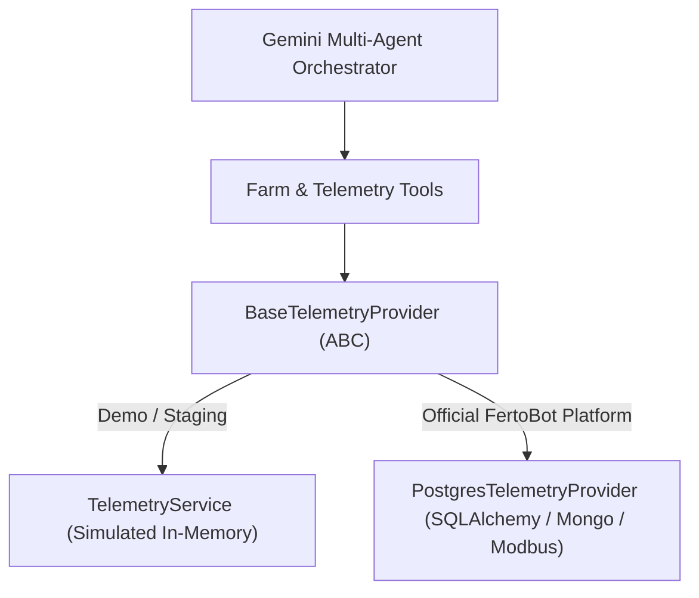

# FertoBot AI Agronomist — Telemetry Adapter Contract

This guide instructs the official FertoBot development team on how to connect their production database (PostgreSQL / MongoDB) or IoT ingestion pipeline (MQTT / Modbus / AWS IoT) to the AI Agronomist.

---

## 1. Architecture Overview

The AI Agronomist uses an abstract provider interface (`BaseTelemetryProvider`) to decouple agent reasoning, prompt grounding, and safety checks from specific data storage technologies.



By subclassing `BaseTelemetryProvider`, the official platform team can replace the demo in-memory dataset with real database queries **without modifying a single line of agent reasoning, prompt construction, or conversation logic**.

---

## 2. Abstract Base Class Definition

File location: `ai_agronomist/providers/telemetry_base.py`

```python
from abc import ABC, abstractmethod
from typing import Any, Dict, List, Optional

class BaseTelemetryProvider(ABC):
    """
    Abstract contract for agricultural telemetry sources.
    Both simulated (demo) and physical (production) telemetry adapters
    must implement this interface to be utilized by the AI Agronomist specialist agents.
    """

    @property
    def is_simulation(self) -> bool:
        """Returns True if the provider operates in demo/simulated mode, False for live production."""
        return True

    @abstractmethod
    def get_farm_overview(self) -> Dict[str, Any]:
        """
        Returns high-level summary of the entire farm, including all active zones,
        current overall status, and main water reservoir telemetry.
        """
        pass

    @abstractmethod
    def get_active_zone_id(self) -> str:
        """Returns the default or currently selected active zone ID (e.g. 'DEMO-ZONE-001')."""
        pass

    @abstractmethod
    def set_active_zone_id(self, zone_id: str) -> bool:
        """Updates the currently selected active zone ID."""
        pass

    @abstractmethod
    def get_zone(self, zone_id: Optional[str] = None) -> Optional[Dict[str, Any]]:
        """Returns metadata for the requested zone (crop, variety, soil type, coordinates). Returns None if unknown."""
        pass

    @abstractmethod
    def get_latest_telemetry(self, zone_id: Optional[str] = None) -> Dict[str, Any]:
        """
        Returns the most recent 7-in-1 soil probe reading for the specified zone:
        - soil_moisture_pct (%)
        - soil_temperature_c (°C)
        - electrical_conductivity_ds_m (dS/m)
        - ph (pH scale 0-14)
        - nitrogen_mg_kg (mg/kg)
        - phosphorus_mg_kg (mg/kg)
        - potassium_mg_kg (mg/kg)
        - battery_level_pct (%)
        - reading_timestamp_iso (ISO 8601 string)
        Returns empty dict if zone_id is invalid/unknown.
        """
        pass

    @abstractmethod
    def get_historical_telemetry(
        self,
        zone_id: Optional[str] = None,
        parameter: str = "soil_moisture_pct",
        hours: int = 24,
    ) -> Dict[str, Any]:
        """Returns time-series historical records for the specified parameter and time window."""
        pass

    @abstractmethod
    def get_fertilizer_consumption(
        self,
        zone_id: Optional[str] = None,
        window: str = "24h",
    ) -> Dict[str, Any]:
        """
        Returns fertilizer consumption data if physical flow meters exist,
        or explicitly flags volumetric tracking as unavailable (status='unavailable').
        """
        pass

    @abstractmethod
    def calculate_nutrient_depletion_rate(
        self,
        zone_id: Optional[str] = None,
        nutrient: str = "nitrogen",
        window_days: int = 7,
    ) -> Dict[str, Any]:
        """Calculates nutrient depletion rate from historical timestamped readings."""
        pass

    @abstractmethod
    def get_device_status(self, zone_id: Optional[str] = None) -> Dict[str, Any]:
        """Returns probe hardware health, battery level, device_status ('online'/'offline'), and last-seen timestamp."""
        pass

    @abstractmethod
    def get_water_tank_level(self, zone_id: Optional[str] = None) -> Dict[str, Any]:
        """Returns main irrigation reservoir level percentage (water_tank_level_pct) and capacity."""
        pass

    @abstractmethod
    def get_alert_history(self, zone_id: Optional[str] = None) -> Dict[str, Any]:
        """Returns active agronomic and hardware alerts for the zone or farm."""
        pass

    def get_canonical_soil_profile(self, zone_id: Optional[str] = None) -> Any:
        """Returns canonical 7-parameter profile with calibration status and health index."""
        pass

    def get_sodium_status(self) -> Dict[str, Any]:
        """Confirms that sodium is not measured by 7-in-1 sensor probes."""
        return {
            "sodium_measured": False,
            "can_derive_from_ec": False,
            "policy": "FertoBot 7-in-1 sensor does not measure sodium directly or indirectly.",
        }

    def reset_demo_dataset(self) -> None:
        """Resets telemetry state (no-op in live production)."""
        pass
```

---

## 3. Production Implementation Example: PostgreSQL / SQLAlchemy

Here is a ready-to-use adapter connecting the official FertoBot platform database to the AI Agronomist:

```python
from typing import Any, Dict, List, Optional
from datetime import datetime, timedelta, timezone
from ai_agronomist.providers.telemetry_base import BaseTelemetryProvider

class PostgresTelemetryProvider(BaseTelemetryProvider):
    def __init__(self, db_session_factory):
        self._session_factory = db_session_factory
        self._default_zone_id = "ZONE-001"

    @property
    def is_simulation(self) -> bool:
        return False

    def get_active_zone_id(self) -> str:
        return self._default_zone_id

    def set_active_zone_id(self, zone_id: str) -> bool:
        with self._session_factory() as session:
            zone = session.query(ZoneModel).filter_by(id=zone_id).first()
            if zone:
                self._default_zone_id = zone_id
                return True
            return False

    def get_farm_overview(self) -> Dict[str, Any]:
        with self._session_factory() as session:
            zones = session.query(ZoneModel).all()
            return {
                "farm_id": "FERTOBOT-PROD-001",
                "farm_name": "Official Production Farm",
                "zones": [
                    {
                        "zone_id": z.id,
                        "zone_name": z.name,
                        "crop": z.crop,
                        "device_status": z.device_status,
                    }
                    for z in zones
                ],
                "data_source": "production_postgres",
                "is_simulated": False,
            }

    def get_zone(self, zone_id: Optional[str] = None) -> Optional[Dict[str, Any]]:
        zid = zone_id or self._default_zone_id
        with self._session_factory() as session:
            z = session.query(ZoneModel).filter_by(id=zid).first()
            if not z:
                return None
            return {"zone_id": z.id, "crop": z.crop, "variety": z.variety}

    def get_latest_telemetry(self, zone_id: Optional[str] = None) -> Dict[str, Any]:
        zid = zone_id or self._default_zone_id
        with self._session_factory() as session:
            reading = (
                session.query(SensorReadingModel)
                .filter_by(zone_id=zid)
                .order_by(SensorReadingModel.timestamp.desc())
                .first()
            )
            if not reading:
                return {}
            return {
                "zone_id": zid,
                "soil_moisture_pct": reading.moisture,
                "soil_temperature_c": reading.temperature,
                "electrical_conductivity_ds_m": reading.ec,
                "ph": reading.ph,
                "nitrogen_mg_kg": reading.nitrogen,
                "phosphorus_mg_kg": reading.phosphorus,
                "potassium_mg_kg": reading.potassium,
                "battery_level_pct": reading.battery,
                "reading_timestamp_iso": reading.timestamp.isoformat(),
                "data_source": "production_postgres",
                "is_simulated": False,
            }

    def get_historical_telemetry(
        self,
        zone_id: Optional[str] = None,
        parameter: str = "soil_moisture_pct",
        hours: int = 24,
    ) -> Dict[str, Any]:
        zid = zone_id or self._default_zone_id
        cutoff = datetime.now(timezone.utc) - timedelta(hours=hours)
        with self._session_factory() as session:
            readings = (
                session.query(SensorReadingModel)
                .filter(SensorReadingModel.zone_id == zid, SensorReadingModel.timestamp >= cutoff)
                .order_by(SensorReadingModel.timestamp.asc())
                .all()
            )
            points = [
                {"timestamp_iso": r.timestamp.isoformat(), "value": getattr(r, parameter, 0.0)}
                for r in readings
            ]
            return {
                "zone_id": zid,
                "parameter": parameter,
                "hours": hours,
                "points": points,
                "data_source": "production_postgres",
            }

    def get_fertilizer_consumption(self, zone_id: Optional[str] = None, window: str = "24h") -> Dict[str, Any]:
        return {
            "zone_id": zone_id or self._default_zone_id,
            "available": False,
            "status": "unavailable",
            "reason": "In-line fertigation flow meters are not installed.",
        }

    def calculate_nutrient_depletion_rate(
        self,
        zone_id: Optional[str] = None,
        nutrient: str = "nitrogen",
        window_days: int = 7,
    ) -> Dict[str, Any]:
        zid = zone_id or self._default_zone_id
        cutoff = datetime.now(timezone.utc) - timedelta(days=window_days)
        with self._session_factory() as session:
            readings = (
                session.query(SensorReadingModel)
                .filter(SensorReadingModel.zone_id == zid, SensorReadingModel.timestamp >= cutoff)
                .order_by(SensorReadingModel.timestamp.asc())
                .all()
            )
            if len(readings) < 2:
                return {"success": False, "reason": "Insufficient historical data"}
            initial = getattr(readings[0], nutrient, 0.0)
            final = getattr(readings[-1], nutrient, 0.0)
            elapsed_days = (readings[-1].timestamp - readings[0].timestamp).total_seconds() / 86400.0
            rate = (initial - final) / elapsed_days if elapsed_days > 0 else 0.0
            return {
                "success": True,
                "zone_id": zid,
                "nutrient": nutrient,
                "initial_value": initial,
                "final_value": final,
                "depletion_rate_per_day": round(rate, 2),
            }

    def get_device_status(self, zone_id: Optional[str] = None) -> Dict[str, Any]:
        zid = zone_id or self._default_zone_id
        with self._session_factory() as session:
            device = session.query(DeviceModel).filter_by(zone_id=zid).first()
            if not device:
                return {"device_status": "unknown"}
            return {
                "device_id": device.id,
                "device_status": device.status,
                "battery_level_pct": device.battery,
                "last_seen_iso": device.last_seen.isoformat(),
            }

    def get_water_tank_level(self, zone_id: Optional[str] = None) -> Dict[str, Any]:
        # Farm-wide water tank level
        return {"water_tank_level_pct": 85.0}

    def get_alert_history(self, zone_id: Optional[str] = None) -> Dict[str, Any]:
        return {"alerts": []}
```

---

## 4. Injecting into AI Agronomist at Startup

In your official FastAPI entrypoint:

```python
from fastapi import FastAPI
from ai_agronomist import (
    ai_agronomist_router,
    set_global_telemetry_provider,
)
from my_app.telemetry import PostgresTelemetryProvider

app = FastAPI(title="FertoBot Production Platform")

# 1. Inject live database adapter
live_telemetry_adapter = PostgresTelemetryProvider(db_session_factory)
set_global_telemetry_provider(live_telemetry_adapter)

# 2. Mount AI Agronomist router
app.include_router(ai_agronomist_router, prefix="/api")
```

The AI Agronomist will immediately ground all conversational reasoning and tool calls on your production PostgreSQL database.
