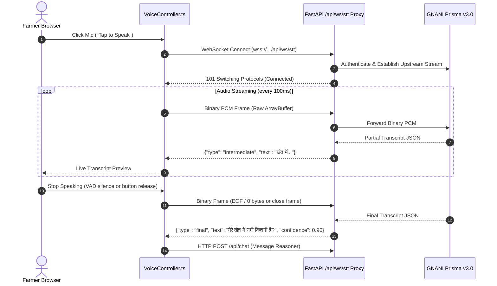

# FertoBot AI Agronomist — Streaming WebSocket Specification

This document details the real-time Speech-to-Text streaming WebSocket protocol implemented in the FertoBot AI Agronomist.

## Endpoint
- **URL**: `wss://<host>/api/ws/stt` (when mounted with `prefix="/api"`) or `wss://<host>/ws/stt`
- **Protocol**: Raw WebSocket (RFC 6455)
- **Subprotocols**: None required

---

## 1. Audio Stream Requirements

The streaming STT bridge connects the farmer's browser microphone directly to GNANI Prisma v3.0 via a persistent server-side WebSocket proxy.

| Parameter | Specification | Notes |
| :--- | :--- | :--- |
| **Encoding** | Linear PCM (`audio/pcm`) | 16-bit Signed Integer, Little-Endian |
| **Sample Rate** | 16,000 Hz (16 kHz) | Downsampled in browser via AudioWorklet/ScriptProcessor |
| **Channels** | 1 (Mono) | Left channel or averaged stereo |
| **Frame Interval** | 100 ms – 200 ms | 1600 – 3200 samples per buffer |
| **Frame Size** | 3,200 – 6,400 bytes | Raw uncompressed PCM bytes |

---

## 2. Session Lifecycle & Frame Format



---

## 3. Server-to-Client Message Protocol

All messages delivered from `/api/ws/stt` to the browser client are JSON strings formatted as follows:

### A. Intermediate (Partial) Transcript
Streamed incrementally as the farmer is speaking:
```json
{
  "type": "intermediate",
  "text": "मेरे खेत",
  "is_final": false,
  "confidence": 0.88
}
```

### B. Final Transcript
Emitted when an utterance boundary or silence pause is detected:
```json
{
  "type": "final",
  "text": "मेरे खेत में पानी की कमी कहाँ है?",
  "is_final": true,
  "confidence": 0.95,
  "language": "hi-IN"
}
```

### C. Error Notification
Emitted when upstream network, credential, or audio formatting errors occur:
```json
{
  "type": "error",
  "code": "STT_PROXY_ERROR",
  "message": "GNANI streaming endpoint unavailable. Falling back to HTTP batch transcription."
}
```

---

## 4. Host Reverse Proxy & Timeout Management

When deploying behind reverse proxies such as Cloudflare, Nginx, or Render:

1. **Proxy Mounting**: When mounting `ai_agronomist_router` into your FastAPI application:
   ```python
   from ai_agronomist import ai_agronomist_router
   app.include_router(ai_agronomist_router, prefix="/api")
   ```
   The WebSocket endpoint is exposed at `/api/ws/stt`. Both the frontend `VoiceController.ts` and standard reverse proxies will route `wss://<host>/api/ws/stt` directly to this handler.

2. **Nginx Configuration**:
   ```nginx
   location /api/ws/ {
       proxy_pass http://127.0.0.1:8000;
       proxy_http_version 1.1;
       proxy_set_header Upgrade $http_upgrade;
       proxy_set_header Connection "upgrade";
       proxy_read_timeout 300s;
       proxy_send_timeout 300s;
   }
   ```

3. **Ping/Pong Heartbeats**: The client `VoiceController` sends a ping frame or 2-byte empty ping buffer every 15 seconds to prevent proxy idle disconnection (Render default timeout is 55 seconds).

4. **Graceful Fallback**: If the WebSocket stream encounters `WebSocketDisconnect`, connection failure, or handshake rejection (HTTP 401/502), `VoiceController` automatically falls back to base64 HTTP audio recording via `POST /api/stt` without breaking the conversational flow.
