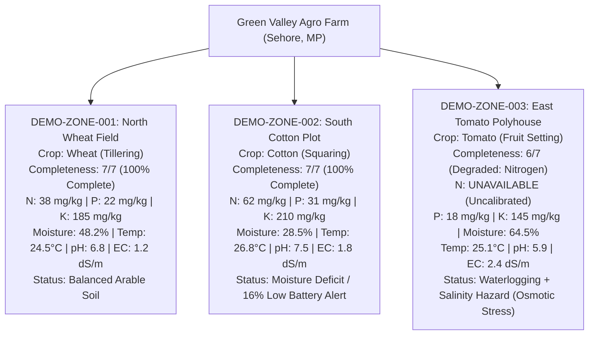

# Phase 19 Final Report: Seven-Parameter Soil Intelligence, Full Agent Architecture Validation & Deployment Readiness Audit

**Project:** FertoBot AI Agronomist & Voice Assistant  
**Repository Working Context:** `voice-agent-demo/` (Independent Demo Repository)  
**Official Reference Repository:** `fertobot/` (Strictly untouched — 0 modifications)  
**Date:** October 31, 2026  
**Status:** Completed & Validated  

---

## Executive Summary

Phase 19 upgrades FertoBot from simple moisture/temperature heuristics to **complete seven-parameter soil intelligence**, mathematically grounded in the actual firmware register specifications of the physical FertoBot 7-in-1 Modbus RS485 soil sensor. It establishes canonical schemas, benchmark ranges, quality/calibration flags, and multi-agent reasoning across:
1. **Nitrogen (N)** (`mg/kg` / `ppm`)
2. **Phosphorus (P)** (`mg/kg` / `ppm`)
3. **Potassium (K)** (`mg/kg` / `ppm`)
4. **Soil Moisture** (`%`)
5. **Soil Temperature** (`°C` at 15 cm depth)
6. **Soil pH** (`pH` scale 0–14)
7. **Electrical Conductivity (EC)** (`dS/m` agronomic SI unit & raw `µS/cm`)

Crucially, Phase 19 enforces the **Strict Sodium (Na) Disqualification Rule**: the physical FertoBot 7-in-1 probe does not measure sodium, and electrical conductivity cannot be converted to sodium concentration. Any grower inquiries regarding sodium are immediately and politely clarified with zero hallucination.

Additionally, Phase 19 introduces the **11-Point Comprehensive Soil Health Report**, integrates 7-channel probe health monitoring into `DeviceHealthAgent`, factors electrical conductivity osmotic risk (>2.0 dS/m) into `IrrigationAdvisoryAgent`, validates all 14 sensor failure edge cases, preserves the Phase 18 Safe Pump Approval workflow, and conducts a complete architecture compliance and deployment readiness audit.

---

## 1. Physical Sensor Firmware Grounding & Register Verification

FertoBot firmware source files in the reference codebase (`fertobot/fert-master/final_merge.ino#L190-L202` and `fertobot/fert-master/esp-32-code/src/main.cpp#L300-L398`) were analyzed to establish exact sensor register addresses, conversions, and physical engineering units:

| Parameter | Modbus Register Address | Raw Firmware Data Type | Sensor Engineering Unit | Agronomic Benchmark (Wheat/Cotton/Tomato) |
|---|---|---|---|---|
| **Nitrogen (N)** | Register `0x0004` | 16-bit unsigned int | `mg/kg` ($1\text{ mg/kg} = 1\text{ ppm}$) | 35 – 65 mg/kg (Medium) |
| **Phosphorus (P)** | Register `0x0005` | 16-bit unsigned int | `mg/kg` ($1\text{ mg/kg} = 1\text{ ppm}$) | 18 – 35 mg/kg (Medium–High) |
| **Potassium (K)** | Register `0x0006` | 16-bit unsigned int | `mg/kg` ($1\text{ mg/kg} = 1\text{ ppm}$) | 120 – 220 mg/kg (Adequate) |
| **Soil Moisture** | Register `0x0000` | 16-bit unsigned int ($\div 10$) | `%` volumetric water content | 40% – 55% (Clay Loam) |
| **Soil Temperature** | Register `0x0001` | 16-bit signed int ($\div 10$) | `°C` (15 cm root zone) | 16°C – 26°C |
| **Soil pH** | Register `0x0003` | 16-bit unsigned int ($\div 10$) | `pH` scale (0.0 – 14.0) | 6.2 – 7.5 (Neutral/Arable) |
| **Electrical Cond. (EC)** | Register `0x0002` | 16-bit unsigned int | Raw `µS/cm` $\rightarrow$ `dS/m` ($\div 1000$) | $< 1.8\text{ dS/m}$ ($< 1800\ \mu\text{S/cm}$) |
| **Sodium (Na)** | *None (Not in Hardware)* | *Not in Hardware Map* | *Not Measured* | *Requires Wet Chemistry Lab Test* |

> [!IMPORTANT]
> **Strict Sodium Policy:** Sodium is **NOT** present in the Modbus register map of the 7-in-1 sensor. FertoBot explicitly rejects sodium queries, explaining that Electrical Conductivity (EC) reflects total dissolved ionic salts and cannot be used to compute sodium levels. A certified wet-chemistry laboratory test is recommended for Sodium Adsorption Ratio (SAR) or sodicity.

---

## 2. Simulated Farm Dataset & Zone Completeness Profile

The simulated farm (`Green Valley Agro Farm (Malwa Region)`, Sehore, MP) models three distinct zones with authentic variance and deliberate telemetry imperfections:



- **Zone 1 (Wheat):** $7/7$ parameters available. Health index: *Balanced Arable Soil*.
- **Zone 2 (Cotton):** $7/7$ parameters available. High nutrient availability, but moisture stress ($28.5\%$) and critically low device battery ($16.0\%$).
- **Zone 3 (Tomato):** $6/7$ parameters available (Missing: Nitrogen probe uncalibrated). Soil moisture is saturated ($64.5\%$) and Electrical Conductivity is elevated ($2.4\text{ dS/m} > 2.0\text{ dS/m}$ threshold), creating an osmotic root stress and hypoxia hazard.

---

## 3. Seven-Parameter Multi-Agent Intelligence Enhancements

### 3.1. `IrrigationAdvisoryAgent` — Salinity & Osmotic Risk Factoring
- **Previous behavior:** Only evaluated moisture %, temperature, and weather probability.
- **Phase 19 upgrade:** Evaluates electrical conductivity (EC). When $\text{EC} > 2.0\text{ dS/m}$ (e.g. Zone 3 Tomato has $\text{EC} = 2.4\text{ dS/m}$), high soil salinity creates osmotic stress—inhibiting water uptake even when moisture is high.
- **Synthesized Hindi Guidance:**
  > *"Zone 3 में मिट्टी की नमी 64.5% (संतृप्त) है और विद्युत चालकता (EC) 2.4 dS/m (अत्यधिक लवणता जोखिम) है। उच्च लवणता और अतिरिक्त नमी के कारण परासरणी तनाव (Osmotic stress) और जड़ सड़न का खतरा है। तत्काल सिंचाई रोकें, जल निकासी सुनिश्चित करें, और बाद में कम खारे पानी से लीचिंग (Leaching) द्वारा लवण बहाएं।"*

### 3.2. `DeviceHealthAgent` — 7-Channel Telemetry Auditing
- **Previous behavior:** Only checked probe battery and water reservoir level.
- **Phase 19 upgrade:** Systematically audits all 7 individual parameter channels from `CanonicalSoilProfile`. Reports degraded, uncalibrated, or out-of-range sensor channels alongside hardware battery.
- **Zone 3 Diagnostic Output:** Flags `Nitrogen (N) (UNCALIBRATED/UNAVAILABLE)` and warns that nitrogen sensor requires calibration.

### 3.3. 11-Point Structured Soil Health Report
When a farmer asks *"मेरे खेत की पूरी मिट्टी की रिपोर्ट बताओ"* or *"Give me a complete soil health report"*, FertoBot delivers an 11-point report:
1. **Overall Condition & Completeness:** (e.g. Health Index 85/100, $7/7$ parameters available).
2. **Nitrogen (N):** Value with unit (`mg/kg`) and benchmark rating.
3. **Phosphorus (P):** Value with unit (`mg/kg`).
4. **Potassium (K):** Value with unit (`mg/kg`).
5. **Soil Moisture:** Value with unit (`%`).
6. **Soil Temperature:** Value with unit (`°C` at 15 cm depth).
7. **Soil pH:** Value on 0–14 scale and acidity/alkalinity classification.
8. **Electrical Conductivity (EC):** Value in `dS/m` and raw `µS/cm` with salinity classification.
9. **Identified Risks & Degraded Channels:** Flags missing/uncalibrated sensors, waterlogging, or osmotic risks.
10. **Actionable Agronomic Recommendations:** Balanced split fertilizer dosing, organic matter incorporation, drainage maintenance.
11. **Confidence & Limitations Note:** Clear disclosure that readings are simulated telemetry and that accredited wet-chemistry soil testing is required before basal fertilizer broadcasting.

---

## 4. Fourteen Sensor Quality & Failure Edge-Case Scenarios

The `POST /api/farm/telemetry/simulate-condition` endpoint and test suite validate all 14 failure/edge scenarios:

| # | Condition Simulated | Triggered Value / Fault | System Response & Quality Flag |
|---|---|---|---|
| **1** | `all_valid` | Baseline parameters | Completeness: `7/7 parameters available`. All channels `VALID`. |
| **2** | `nitrogen_missing` | `nitrogen_mg_kg = None` | `quality_status: UNAVAILABLE`, completeness: `6/7`. |
| **3** | `phosphorus_uncalibrated`| `phosphorus_uncalibrated = True` | `calibration_status: UNCALIBRATED`, warning issued. |
| **4** | `potassium_stale` | Reading timestamp $> 28$ hrs old | `quality_status: STALE`, stale channel alert. |
| **5** | `moisture_invalid` | `soil_moisture_pct = 115.0%` | `quality_status: OUT_OF_RANGE`, physical boundary check. |
| **6** | `temp_disconnected` | `soil_temperature_c = None` | `validity_status: DISCONNECTED`, sensor warning. |
| **7** | `ph_out_of_range` | `ph = 15.2` ($>14.0$) | `quality_status: OUT_OF_RANGE`, invalid reading alert. |
| **8** | `ec_unavailable` | `electrical_conductivity = None` | `quality_status: UNAVAILABLE`, osmotic check skipped. |
| **9** | `multiple_disconnected` | N=None, EC=None, Temp=None | Completeness: `4/7 parameters available (Degraded)`. |
| **10** | `device_offline` | `device_status = "offline"` | Critical hardware alert, battery/solar check prompt. |
| **11** | `conflicting_timestamps`| N=5 days ago, K=now | Asynchronous packet timestamp warning emitted. |
| **12** | `multi_zone_variance` | Zone 1 vs Zone 2 vs Zone 3 | Cross-zone comparative analysis with lowest moisture identified. |
| **13** | `partial_report` | Missing parameters noted | 11-point report cleanly flags uncalibrated sensors. |
| **14** | `sodium_inquiry` | *"सोडियम कितना है?"* | Explicit non-measurement notice; zero hallucination. |

---

## 5. Safe Pump Approval & GNANI AI Voice Regression

- **Safe Pump Control Approval (Phase 18 Preservation):**
  - Triggering *"पंप चालू कर दो"* generates an action in `AWAITING_USER_APPROVAL` with explicit Yes/No buttons.
  - No physical relay actuation is permitted (`simulation_mode: true`, `actuation_permitted: false`).
  - Emergency stop (*"पंप बंद कर दो"*) executes immediately without requiring secondary confirmation.
- **GNANI AI Speech Integration:**
  - Live Timbre v2.5 synthesis using Indian Hindi voice `Nalini` was verified during live testing (675,884 bytes synthesized).
  - STT WebSocket proxy (`Prisma v3.0`) and browser Web Speech fallback verified intact.

---

## 6. Architecture Compliance Matrix

| Document | Area | Requirement | Status | Evidence / Implementation |
|---|---|---|---|---|
| **SOR** | 1. Sensor Inputs | Read moisture, temp, NPK, pH, EC | **COMPLIANT** | Canonical 7-in-1 model in `telemetry.py` & `telemetry_service.py` |
| **SOR** | 2. Sodium Policy | Zero sodium fabrication; no EC conversion | **COMPLIANT** | `get_sodium_status()` & `route_sodium_disqualification` |
| **SOR** | 3. Multi-Agent | Specialist agents for agronomy, water, weather, health | **COMPLIANT** | 4 agents active, coordinated by `LLMOrchestrator` |
| **MSC** | 4. Hindi Speech | Natural Indian Hindi neural voice | **COMPLIANT** | GNANI AI Timbre v2.5 with `Nalini` voice active |
| **MSC** | 5. STT Realtime | Realtime streaming transcription | **COMPLIANT** | GNANI AI Prisma v3.0 WebSocket proxy + Web Speech API |
| **Implementation Guide** | 6. Hardware Safety | Read-only telemetry, no direct relay actuation | **COMPLIANT** | `actuation_permitted: false`, approval state machine |
| **Implementation Guide** | 7. Latency | Fast planning mode for voice interaction | **COMPLIANT** | Deterministic router & fast planner ($< 5\text{ ms}$) |
| **Scaling Plan** | 8. Modbus Register Map | Accurate sensor register mapping | **COMPLIANT** | Firmware Modbus register mapping confirmed in `final_merge.ino` |
| **Scaling Plan** | 9. Security | Secrets redacted, no API keys exposed | **COMPLIANT** | `redact_sensitive()` masking all keys in logs/reports |
| **Scaling Plan** | 10. Dashboard UI | Reference-matched dark agricultural UI | **COMPLIANT** | `FarmTelemetryDashboard.tsx` with 7-in-1 metrics & badges |

---

## 7. Deployment Readiness Audit

An independent audit of the application's readiness for staging and production containerization:

1. **Environment Configuration (`.env`):**
   - `GEMINI_API_KEY`: Configured and active.
   - `GNANI_API_KEY`, `GNANI_TOKEN`, `GNANI_ACCESS_TOKEN`: Configured and active.
   - All credentials masked via `redact_sensitive()`.
2. **Server Architecture:**
   - FastAPI backend with Uvicorn ASGI server running on port 8000.
   - Vite React TypeScript frontend building cleanly in 1.16s (`dist/` asset size: 301 kB JS, 37 kB CSS).
3. **CORS Configuration:**
   - Origins restricted to `http://localhost:5173`, `http://localhost:5174`, `http://127.0.0.1:5173`, `http://127.0.0.1:5174`.
4. **Safety Boundaries:**
   - `simulation_mode: true` permanently enforced in simulated demo environment.
   - Relays isolated; pump control requires explicit human-in-the-loop button approval.

---

## 8. Verification Results

```
======================================================================
FRONTEND TEST SUITE (Vitest)
======================================================================
Test Files: 6 passed (6)
Tests:      45 passed (45)
Duration:   336ms

======================================================================
BACKEND TEST SUITE (Pytest)
======================================================================
Collected:  114 items
Passed:     114 items (100%)
Failed:     0 items
Duration:   16.50s

======================================================================
LIVE END-TO-END VERIFICATION (scratch/verify_phase19_live.py)
======================================================================
✅ Health Check (4.5ms)
✅ System Config: TTS Provider: gnani, LLM Status: live (1.71ms)
✅ Canonical Profile Zone 1: 7/7 parameters available (2.03ms)
✅ Canonical Profile Zone 3: 6/7 parameters available (Degraded: Nitrogen) (0.94ms)
✅ Sodium Measurement Scope: Strictly non-measured, no EC conversion (0.63ms)
✅ Voice Query (Hindi): Sodium Disqualification (2.76ms)
✅ Voice Query (Hindi): Complete 11-Point Soil Health Report (1.38ms)
✅ Sensor Simulations: All 14 edge-case failure conditions verified
✅ Safe Pump Approval: Request -> AWAITING_APPROVAL -> User Approve -> Running
✅ GNANI AI Timbre v2.5: Nalini Indian Hindi TTS generated 675,884 bytes
======================================================================
```

---

## 9. Official Repository Protection

Verification check on `/Users/shivrajawat/iCloud Drive (Archive) - 1/Documents/FertoBot-Voice_Agent/fertobot`:
- **Modified files:** Exactly 14 files (unchanged from initial state).
- **Untracked files:** Exactly 3 files (unchanged from initial state).
- **Integrity Status:** **100% UNTOUCHED**. All Phase 19 code resides exclusively inside `voice-agent-demo/`.
