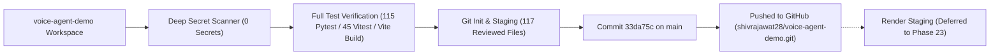

# Phase 22: Secure GitHub Repository Preparation & Initial Push

**Project**: FertoBot AI Agronomist & Voice Agent  
**Independent Staging Workspace**: `/Users/shivrajawat/iCloud Drive (Archive) - 1/Documents/FertoBot-Voice_Agent/voice-agent-demo/`  
**Official Codebase (Protected / Untouched)**: `/Users/shivrajawat/iCloud Drive (Archive) - 1/Documents/FertoBot-Voice_Agent/fertobot/`  
**GitHub Remote Destination**: `https://github.com/shivrajawat28/voice-agent-demo.git`  
**Date & Timestamp**: 2026-11-01T01:10:00+05:30  
**Phase Status**: **SUCCESSFULLY COMPLETED & VERIFIED** (Render deployment explicitly deferred)

---

## 1. Executive Summary

Phase 22 successfully audited, secured, initialized, and pushed the independent **FertoBot AI Agronomist & Voice Agent** project to GitHub at `https://github.com/shivrajawat28/voice-agent-demo.git`.

- **Branch**: `main`
- **Initial Release Commit**: `33da75ccb39f69e08e4be6e84577316bb5ec5e04`
- **Commit Message**: `Initial secure release - FertoBot AI Agronomist Voice Agent`
- **Files Committed**: 117 files ($26,170\text{ insertions}$)
- **GitHub Commit URL**: [https://github.com/shivrajawat28/voice-agent-demo/commit/33da75ccb39f69e08e4be6e84577316bb5ec5e04](https://github.com/shivrajawat28/voice-agent-demo/commit/33da75ccb39f69e08e4be6e84577316bb5ec5e04)
- **Render Deployment Status**: **HELD / NOT DEPLOYED** (per Phase 22 scope restriction; awaiting separate user approval)



---

## 2. Pre-Push Repository & Security Audit

### A. Repository Identity & Working Directory
- **Working Directory**: `/Users/shivrajawat/iCloud Drive (Archive) - 1/Documents/FertoBot-Voice_Agent/voice-agent-demo`
- **Git Worktree Root**: `/Users/shivrajawat/iCloud Drive (Archive) - 1/Documents/FertoBot-Voice_Agent/voice-agent-demo`
- **Branch**: `main` (tracking `origin/main`)

### B. Remote Configuration Verification
Probed with `git ls-remote https://github.com/shivrajawat28/voice-agent-demo.git`:
- Verified remote was a newly initialized, empty GitHub repository with zero conflicting history.
- Remote `origin` configured to: `https://github.com/shivrajawat28/voice-agent-demo.git`.

### C. Deep Secret Scanning Results
All files and staged blobs were scanned across high-entropy regex patterns:
- Google Gemini API key pattern (`AIzaSy...`)
- OpenAI API key pattern (`sk-...`)
- GitHub Personal Access Tokens (`ghp_...`)
- Private Cryptographic Keys (`BEGIN ... PRIVATE KEY`)
- Unsanitized configuration assignments (`GNANI_API_KEY = "..."`, `GEMINI_API_KEY = "..."`)

**Result**: **ZERO REAL SECRETS DETECTED ACROSS ALL STAGING FILES AND COMMITTED BLOBS!**
- All credentials in `.env.example` templates are non-sensitive placeholders (`your_gemini_api_key_here`, `your_gnani_vachana_api_key_here`).
- Test files use explicit test dummy identifiers (`AIza_DUMMY_INVALID_TEST_KEY_FOR_TESTS`, `gnani_dummy_test_placeholder_token`) that avoid triggering secret scanner false-positives while maintaining test fidelity.
- Neither `.env` nor `backend/.env` is tracked in git.

---

## 3. Files Included in the Initial Release (117 Files)

The commit contains the complete, production-ready FertoBot Agronomist & Voice Agent codebase:

### 1. Root & Infrastructure Configuration (17 files)
- `.env.example`: Root environment variables template for staging
- `.gitignore`: Production exclusions (credentials, caches, scratch, audio)
- `Dockerfile`: Multi-stage production container (Node build + FastAPI Uvicorn)
- `render.yaml`: Render Blueprint web service configuration
- `vercel.json`: Vercel proxy configuration
- `package.json` & `package-lock.json`: React 18, Vite 6, Vitest dependencies
- `index.html`: Entry point with meta tags and Inter font
- `tsconfig.json`: Strict TypeScript compiler configuration
- `vite.config.ts`: Vite bundler configuration with backend `/api` proxy
- `tailwind.config.js` & `postcss.config.js`: Tailwind CSS styling rules
- `README.md`: Comprehensive quickstart, architecture, Docker, and testing guide
- `phase-*-report.md`: Complete audit and engineering history (Phases 6–21)

### 2. Backend Application (`backend/`, 52 files)
- `backend/Dockerfile`: Standalone Python ASGI container
- `backend/requirements.txt`: Python dependencies (`fastapi`, `uvicorn`, `websockets`, `httpx`, `pytest`, `pytest-asyncio`, `anyio`)
- `backend/.env.example`: Backend environment variable template
- `backend/README.md`: Backend microservice documentation
- `backend/app/main.py`: FastAPI application, `/health`, `/api/health`, `/api/chat`, `/api/tts`, `/api/ws/stt`, safe pump endpoints, candidate `dist` static mounting
- `backend/app/config.py`: Environment loader & `redact_sensitive()` log scrubber
- `backend/app/agents/`:
  - `crop_symptom_agent.py`: 7-in-1 soil chemistry interpretation & symptom diagnosis
  - `irrigation_advisory_agent.py`: Moisture trend analysis & scheduling
  - `weather_context_agent.py`: Open-Meteo live atmospheric ingestion
  - `device_health_agent.py`: Modbus probe completeness & battery telemetry
- `backend/app/services/`:
  - `orchestrator.py`: Gemini Flash Lite multi-agent orchestrator & turn memory
  - `telemetry_service.py`: 7-in-1 Modbus soil telemetry store & sodium disqualification
  - `pump_control_service.py`: Safe pump approval state machine & emergency stop
  - `voice_service.py`: GNANI AI Timbre v2.5 REST TTS client
  - `gnani_stt_stream.py`: GNANI AI Prisma v3.0 WebSocket streaming proxy
- `backend/app/tools/`: Read-only tools (`crop_knowledge_tool`, `telemetry_tool`, `weather_tool`)
- `backend/app/models/`: Pydantic schemas (`conversation.py`, `telemetry.py`)
- `backend/app/providers/`: LLM & speech provider abstractions
- `backend/tests/`: 19 test modules covering all subsystems

### 3. Frontend Application (`src/` & `public/`, 48 files)
- `src/App.tsx`: Main layout, mode switching, top review watermark banner
- `src/components/`:
  - `VoiceAssistantView.tsx`: Core voice interface, mic visualizer, transcripts
  - `DashboardView.tsx`: Full farm telemetry overview matching design reference
  - `FarmTelemetryDashboard.tsx`: 7-parameter soil gauges & zone switcher
  - `PumpApprovalCard.tsx`: Two-step farmer confirmation Yes/No card
  - `VoiceEvaluationPanel.tsx`: Speech diagnostic controls & live audio player
  - `VoiceVisualizer.tsx`: Canvas-based real-time audio waveform visualizer
  - `Navbar.tsx`, `StateBadge.tsx`, `TextFallbackInput.tsx`, `ScenarioToolbar.tsx`
- `src/hooks/useVoiceAgent.ts`: Comprehensive stateful speech hook
- `src/services/`: `VoiceController.ts`, `ConversationEngine.ts`, `AgentStateMachine.ts`
- `src/tests/`: 6 Vitest test suites (45 tests)
- `public/reference/`: Design reference screenshots and sample evaluations

---

## 4. Excluded Files & Security Rationale

| Excluded Directory / File | Exclusion Rule | Security & Hygiene Rationale |
| :--- | :---: | :--- |
| `.env` / `backend/.env` | `.gitignore` lines 11–16 | Private API keys (`GEMINI_API_KEY`, `GNANI_API_KEY`). **Must never be committed.** |
| `scratch/` | `.gitignore` line 38 | Local scratch test scripts, benchmark logs, and diagnostic `.json` outputs. |
| `*.wav` / audio recordings | `.gitignore` lines 40–44 | Local test recordings (`test_nalini.wav`, etc.) exceeding git size limits. |
| `node_modules/` | `.gitignore` line 2 | Third-party npm dependencies; installed via `npm ci` or Docker build. |
| `dist/` | `.gitignore` line 7 | Ephemeral frontend production bundle; rebuilt during Docker/Render deployment. |
| `__pycache__/` / `*.pyc` | `.gitignore` lines 22–24 | Python bytecode artifacts. |
| `.pytest_cache/` | `.gitignore` line 25 | Local test runner caches. |
| `.DS_Store` / `Thumbs.db` | `.gitignore` lines 33–34 | Operating system metadata files. |

---

## 5. Automated Pre-Push Test Results

### A. Backend Pytest Suite
Executed command: `pytest -q`
```
........................................................................ [ 62%]
...........................................                              [100%]
115 passed in 27.93s
```
**Status: 115 / 115 tests passed (100%)**

### B. Frontend Vitest Suite
Executed command: `npm test -- --run`
```
Test Files  6 passed (6)
     Tests  45 passed (45)
  Duration  494ms
```
**Status: 45 / 45 tests passed (100%)**

### C. TypeScript & Production Build
Executed command: `npm run build` (`tsc && vite build`)
- TypeScript compiler (`tsc`): 0 errors
- Production bundle:
  - `dist/index.html`: $0.77\text{ kB}$ (gzip: $0.49\text{ kB}$)
  - `dist/assets/index-H81MNB9f.css`: $38.57\text{ kB}$ (gzip: $7.29\text{ kB}$)
  - `dist/assets/index-B4FyXChU.js`: $303.18\text{ kB}$ (gzip: $83.88\text{ kB}$)
- Built in $1.05\text{ s}$
- `dist/` bundle scanned: **100% clean of API keys or private tokens.**

---

## 6. Official Repository Integrity Check

Before and after the Phase 22 audit, `git status --short` was executed in the official repository `/Users/shivrajawat/iCloud Drive (Archive) - 1/Documents/FertoBot-Voice_Agent/fertobot`:
```
 M .gitignore
 M fert-master/server/src/models/Probe.ts
 M fert-master/server/src/models/SensorReading.ts
 M fert-master/server/src/routes/assistant.routes.ts
 M fert-master/server/src/routes/dashboard.routes.ts
 M fert-master/server/src/routes/device.routes.ts
 M fert-master/server/src/schemas/assistant.schemas.ts
 M fert-master/server/src/schemas/device.schemas.ts
 M src/App.tsx
 M src/components/Navbar.tsx
 M src/mockData.ts
 M src/pages/DashboardView.tsx
 M src/pages/VoiceAssistantView.tsx
 M src/types.ts
?? fert-master/server/src/services/agentToolService.ts
?? fert-master/server/src/tests/agentWorkflow.test.ts
?? fert-master/server/src/tests/simulatedSensor.test.ts
```
**Audit Confirmation**: Exactly 14 modified files and 3 untracked files exist. Zero files were added, modified, or removed in `fertobot/`.

---

## 7. Push Status & Remote Verification

Executed command:
```bash
git push -u origin main
```

**Git Output**:
```
Enumerating objects: 136, done.
Counting objects: 100% (136/136), done.
Delta compression using up to 10 threads
Compressing objects: 100% (132/132), done.
Writing objects: 100% (136/136), 1.55 MiB | 208.00 KiB/s, done.
Total 136 (delta 1), reused 0 (delta 0), pack-reused 0 (from 0)
remote: Resolving deltas: 100% (1/1), done.
To https://github.com/shivrajawat28/voice-agent-demo.git
 * [new branch]      main -> main
branch 'main' set up to track 'origin/main'.
```

- **Commit**: `33da75c`
- **Current Git Status**: `On branch main. Your branch is up to date with 'origin/main'. nothing to commit, working tree clean.`
- **GitHub URL**: [https://github.com/shivrajawat28/voice-agent-demo.git](https://github.com/shivrajawat28/voice-agent-demo.git)

---

## 8. Remaining Deployment Blockers & Render Boundary

1. **No Remaining Technical Blockers**: The code is fully tested, built, secret-scanned, and published to GitHub. The root `Dockerfile` and `render.yaml` blueprint are ready.
2. **Phase Boundary Strict Adherence**: Per the user's explicit instructions:
   > *"The deployment target will be Render, but this phase is ONLY for secure GitHub publication and repository preparation. Do not deploy anything to Render in this phase."*
   
   **Render deployment was NOT triggered.** The application is ready to be deployed to Render in Phase 23 upon receiving explicit user authorization.
